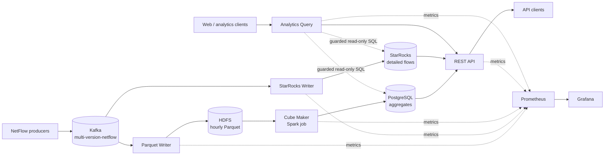

# Nimbyte

Nimbyte is a production-oriented network-flow analytics platform. It ingests Avro-encoded NetFlow events from Kafka and serves them through two complementary data paths:

- a low-latency path that writes detailed events to StarRocks for current-data exploration; and
- a batch path that stores hourly Parquet files in HDFS, computes aggregates with Spark, and publishes them to PostgreSQL.

The platform also includes a REST API, a guarded natural-language analytics service, Kubernetes packaging, infrastructure automation, dashboards, alerting, and CI/CD pipelines.

> **Deployment notice**
>
> This repository contains environment-specific defaults in some configuration, Helm, Ansible, and operational-documentation files. Treat them as examples of the original deployment, not safe universal defaults. Review and override endpoints, image registries, storage classes, credentials, replica counts, retention, and exposure settings before using the project in another environment. Never commit real secrets.

## Contents

- [System overview](#system-overview)
- [Architecture](#architecture)
- [Processing and consistency guarantees](#processing-and-consistency-guarantees)
- [Repository layout](#repository-layout)
- [Technology stack](#technology-stack)
- [Prerequisites](#prerequisites)
- [Build and test](#build-and-test)
- [Configuration](#configuration)
- [Run the applications](#run-the-applications)
- [API guide](#api-guide)
- [Data model and retention](#data-model-and-retention)
- [Kubernetes deployment](#kubernetes-deployment)
- [Infrastructure](#infrastructure)
- [Observability](#observability)
- [Backfill and recovery](#backfill-and-recovery)
- [CI/CD](#cicd)
- [Security](#security)
- [Operations checklist](#operations-checklist)
- [Further documentation](#further-documentation)
- [Contributing](#contributing)
- [Project team](#project-team)
- [License](#license)

## System overview

Nimbyte is designed for workloads that need both recent, detailed flow records and durable historical aggregates.

| Capability | Implementation |
| --- | --- |
| Event transport | Kafka with Schema Registry-managed Avro records |
| Durable raw history | Hourly Parquet files in HDFS |
| Batch computation | Apache Spark |
| Historical aggregate store | PostgreSQL |
| Low-latency detail store | StarRocks |
| Programmatic access | Spring Boot REST API |
| Natural-language access | LLM-assisted analytics with deterministic Java validation and routing |
| Deployment | Helm on Kubernetes; Ansible for Kafka and StarRocks preparation |
| Monitoring | Prometheus, Grafana, Spring Boot Actuator, and repository-managed alert rules |
| Delivery | Jenkins, Maven, Jib, Gerrit, SonarQube, and Nexus |

The active Maven reactor contains seven modules:

1. `common`
2. `parquet-writer`
3. `cube-maker`
4. `starrocks-writer`
5. `starrocks-backfill`
6. `rest-api`
7. `analytics-query`

The `batch-ingester` directory is retained historical material and is not an active Maven module or deployed application.

## Architecture



### Batch path

1. `parquet-writer` consumes Avro records from Kafka.
2. Valid records are written to temporary HDFS objects and atomically renamed to their final hourly Parquet paths.
3. Kafka offsets are committed only after the corresponding output is durable.
4. `cube-maker` discovers unprocessed files and executes Spark aggregations.
5. Large aggregate results are copied into PostgreSQL staging tables and merged into the serving tables.
6. The cube state is advanced only after every output for the batch succeeds.

Final Parquet objects follow this layout beneath the configured HDFS base path:

```text
yyyy-MM-dd/HH/netflow-p<partition>-<UTC timestamp>-<uuid>.parquet
```

### Low-latency path

1. `starrocks-writer` independently consumes the same Kafka stream.
2. It validates and batches records for StarRocks Stream Load.
3. Deterministic load labels, bounded in-flight requests, backend rotation, and retries make loads replay-safe.
4. Kafka offsets are committed after the load completes successfully.

### Query path

`rest-api` exposes PostgreSQL aggregate queries and StarRocks detail queries. `analytics-query` accepts a natural-language question, identifies a supported intent, and prefers a known REST capability. For eligible requests only, it may generate one read-only SQL statement for exactly one configured data source. Java code—not the language model—owns authorization, validation, query-plan checks, execution limits, and final routing.

## Processing and consistency guarantees

The implementation is built to avoid acknowledging data before its sink operation succeeds, but it does **not** provide a global transaction across Kafka, HDFS, StarRocks, Spark, and PostgreSQL.

- Both ingestion services use explicit Kafka offset management and commit after successful sink processing.
- HDFS publication uses a temporary file followed by an atomic rename.
- StarRocks Stream Load labels are derived from Kafka offsets so retries can be recognized.
- Cube writes use stable batch identity and merge semantics; failed batches retain their identity for retry.
- Cube state is persisted only after all aggregations for a batch complete.
- Invalid records are sent to `netflow-dlq` with source metadata when DLQ processing is available.
- Schema evolution supports additive fields and safe type widening; unsafe changes are rejected.
- Time windows and storage timestamps are UTC. User interfaces may format timestamps for a local time zone, but processing semantics remain UTC.

Because the batch and low-latency consumers progress independently, temporary differences between PostgreSQL and StarRocks are expected during delays, retries, maintenance, or backfill. Consumers must not interpret cross-store equality at every instant as a platform guarantee.

## Repository layout

```text
Nimbyte/
├── common/                  Shared validation and model utilities
├── parquet-writer/          Kafka-to-HDFS Parquet ingestion service
├── cube-maker/              Spark aggregation service and Flyway migrations
├── starrocks-writer/        Kafka-to-StarRocks Stream Load service
├── starrocks-backfill/      Controlled HDFS-to-StarRocks repair/backfill CLI
├── rest-api/                PostgreSQL and StarRocks query API
├── analytics-query/         Natural-language analytics API and web UI
├── charts/                  Application Helm charts and umbrella chart
├── infra/
│   ├── ansible/             Kafka and StarRocks provisioning/reconciliation
│   └── helm-charts/         PostgreSQL, Spark, Schema Registry, monitoring
├── jenkins/                 CI/CD definitions and build/deployment helpers
│   ├── Jenkinsfile.ci       Build, test, analysis, and quality gate pipeline
│   ├── Jenkinsfile.cd       Image publication and application deployment
│   ├── Jenkinsfile.prepare  Infrastructure preparation pipeline
│   └── Jenkinsfile.backfill Confirmation-gated StarRocks backfill pipeline
├── docs/                    Architecture, infrastructure, runbooks, and reports
└── pom.xml                  Java 17 multi-module Maven build
```

## Technology stack

The root POM is the authoritative dependency-management source. Major versions currently include:

| Area | Technology |
| --- | --- |
| Language/runtime | Java 17 |
| Application framework | Spring Boot 3.4.3 |
| Messaging | Apache Kafka client 3.9.0, Confluent Avro serializer 7.8.0, Avro 1.11.3 |
| Batch/storage | Apache Spark 4.1.1, Hadoop 3.3.6, Parquet 1.15.0 |
| Databases | PostgreSQL, StarRocks, Flyway 10.17.0, JDBI 3.47.0 |
| Testing | JUnit 5, Mockito, Testcontainers 1.21.4, Awaitility |
| Quality | JaCoCo, Checkstyle, SonarQube |
| Images/deployment | Jib, Kubernetes, Helm 3, Ansible |
| Observability | Micrometer, Prometheus, Grafana |

## Prerequisites

### For development

- JDK 17
- Maven 3.9 or newer
- Git
- A Docker-compatible container runtime for Testcontainers-based integration tests
- Access to the Maven repositories referenced by the project or a correctly configured mirror

### For a complete runtime

- Kafka and a compatible Schema Registry
- HDFS
- Spark
- PostgreSQL
- StarRocks
- An OpenAI-compatible chat-completions endpoint for `analytics-query`

### For deployment and operations

- A Kubernetes cluster and `kubectl`
- Helm 3
- Ansible for the Kafka and StarRocks automation
- A container registry accessible by both the build system and cluster
- Prometheus and Grafana if the supplied monitoring stack is used

There is no Docker Compose definition for a complete local Nimbyte stack. Developers normally connect modules to explicit development dependencies or use the project’s Kubernetes infrastructure.

## Build and test

Run commands from the repository root.

### Full verification

```bash
mvn clean verify
```

This is the closest local equivalent to the main CI verification path. It compiles all active modules, runs unit tests, runs Failsafe integration tests, applies Checkstyle, and produces JaCoCo coverage data. Integration tests use Testcontainers and therefore require a running container engine.

### Unit tests only

```bash
mvn test
```

### Verify one module and its dependencies

```bash
mvn -pl rest-api -am clean verify
mvn -pl analytics-query -am clean verify
```

Replace the module name with any active module listed in [System overview](#system-overview).

### Package without executing tests

Use this only for development iteration, not as a release qualification step:

```bash
mvn -pl rest-api -am clean package -DskipTests
```

## Configuration

Configuration follows Spring Boot property precedence: chart values and environment variables should override repository defaults. Production settings are primarily defined by each chart under `charts/<service>/values.yaml` and rendered through ConfigMaps, Secrets, and Deployment templates.

### Service configuration summary

| Component | Required systems | Important settings |
| --- | --- | --- |
| `parquet-writer` | Kafka, Schema Registry, HDFS | Kafka bootstrap servers, source/DLQ topics, consumer group, Schema Registry URL, HDFS URI/base path/user, rolling thresholds |
| `cube-maker` | HDFS, Spark, PostgreSQL | HDFS path, Spark master, JDBC URL/user/password, schedule, window, file limits, retention |
| `starrocks-writer` | Kafka, Schema Registry, StarRocks | Kafka and Schema Registry endpoints, database/table, Stream Load backends and credentials, batch/concurrency settings |
| `starrocks-backfill` | HDFS visible to StarRocks, StarRocks JDBC | exact UTC interval, HDFS base path/user, JDBC credentials, plan/execute mode |
| `rest-api` | PostgreSQL, StarRocks | `DB_URL`, database credentials, StarRocks query JDBC settings, pools, limits, timeouts |
| `analytics-query` | REST API, LLM endpoint; optional PostgreSQL and StarRocks SQL | LLM URL/key/model, REST base URL, read-only JDBC accounts, validation and result limits |

Do not infer production suitability from a default value in `application.yml`. Several defaults describe the original private environment and must be overridden elsewhere.

### Expected Kubernetes Secrets

The application charts reference existing Secrets rather than treating checked-in values as a credential store.

| Secret | Used by | Expected keys |
| --- | --- | --- |
| `cube-maker-secret` | Cube Maker | `DB_USERNAME`, `DB_PASSWORD` |
| `starrockswriter-secret` | StarRocks Writer | `STARROCKS_USERNAME`, `STARROCKS_PASSWORD` |
| `rest-api-secret` | REST API | `DB_USERNAME`, `DB_PASSWORD`, `STARROCKS_QUERY_USERNAME`, `STARROCKS_QUERY_PASSWORD` |
| `analytics-query-secret` | Analytics Query | LLM API key plus PostgreSQL and StarRocks read-only credentials required by the enabled features |

Confirm the exact key names in the corresponding templates before creating Secrets; chart configuration is authoritative. Provision Secrets through the organization’s secret manager or deployment system, restrict access with RBAC, and rotate any credential that has ever appeared in logs, shell history, documentation, or source control.

### Time and interval rules

- Backend timestamps and query windows use UTC.
- Query intervals are half-open: `[startTime, endTime)`.
- `endTime` must be later than `startTime` and may not be in the future.
- The REST and analytics layers default to a maximum seven-day query range.
- Use ISO-8601 instants such as `2026-09-01T00:00:00Z`.

## Run the applications

Each Spring Boot service can run from Maven after its external dependencies and required environment variables are available.

```bash
mvn -pl rest-api -am package -DskipTests
DB_URL='jdbc:postgresql://postgres.example:5432/nimbo_db' \
DB_USERNAME='<read-only-or-application-user>' \
DB_PASSWORD='<secret>' \
STARROCKS_QUERY_JDBC_URL='jdbc:mysql://starrocks.example:9030/nimbo' \
STARROCKS_QUERY_USERNAME='<read-only-user>' \
STARROCKS_QUERY_PASSWORD='<secret>' \
java -jar rest-api/target/rest-api-1.0.0-SNAPSHOT.jar
```

The example intentionally uses placeholders. Prefer environment injection from a secret manager over inline shell values in shared or production systems.

Default application ports are `8080` when a module is launched directly. The production-oriented Helm charts expose distinct container ports:

| Service | Chart port | Purpose |
| --- | ---: | --- |
| Parquet Writer | 18080 | health and metrics |
| Cube Maker | 18081 | health and metrics |
| StarRocks Writer | 18082 | health and metrics |
| REST API | 18083 | query API, health, and metrics |
| Analytics Query | 18084 | analytics API, web UI, health, and metrics |

Use each module’s `application.yml`, `application-prod.yml`, and chart values together when diagnosing configuration. The chart is authoritative for the deployed profile.

## API guide

### REST API

The REST API uses the `/api` servlet context. PostgreSQL-backed aggregate routes are:

| Method | Route | Description |
| --- | --- | --- |
| `GET` | `/api/traffic/{srcIp}` | Traffic for one source IP |
| `GET` | `/api/traffic` | Paginated traffic query |
| `GET` | `/api/connections/{ip}` | Connections involving an IP |
| `GET` | `/api/connections` | Paginated connection query |
| `GET` | `/api/bandwidth/top` | Highest-bandwidth IPs |
| `GET` | `/api/bandwidth/{ip}` | Bandwidth for one IP |
| `GET` | `/api/protocols` | Protocol usage |
| `GET` | `/api/protocols/{l7Protocol}` | Usage of one application protocol |

StarRocks-backed detail routes currently preserve a case-sensitive controller prefix:

| Method | Route |
| --- | --- |
| `GET` | `/api/StarRocks/traffic/{ip}` |
| `GET` | `/api/StarRocks/connections/{ip}` |
| `GET` | `/api/StarRocks/bandwidth/top` |
| `GET` | `/api/StarRocks/protocols` |

Most query routes accept `startTime` and `endTime`. List routes also support controller-specific pagination, sorting, or limiting. Consult the generated OpenAPI specification for the exact contract:

- Swagger UI: `/api/swagger-ui.html`
- OpenAPI JSON: `/api/api-docs`
- Actuator: `/api/actuator`

Example:

```bash
curl --get 'https://nimbyte.example/api/traffic' \
  --data-urlencode 'startTime=2026-09-01T00:00:00Z' \
  --data-urlencode 'endTime=2026-09-02T00:00:00Z' \
  --data-urlencode 'page=0' \
  --data-urlencode 'size=20'
```

### Analytics Query API

The primary endpoint is:

```http
POST /api/analytics/query
Content-Type: application/json

{"question":"Which source IPs used the most bandwidth yesterday?"}
```

Supporting endpoints are:

- `POST /api/analytics/sql/generate` — generate and validate an eligible read-only query;
- `POST /api/analytics/sql/execute` — execute an explicitly supplied query through the same safety controls.

Swagger UI and OpenAPI are available at `/api/swagger-ui.html` and `/api/api-docs`. Actuator endpoints begin at `/api/actuator`. The module also serves a small browser UI from its static resources.

The response status communicates whether the request succeeded, needs clarification, is unsupported or out of scope, was rejected by policy, encountered an unavailable dependency, or failed during execution. A failed or empty tool call is not silently converted into arbitrary generated SQL.

### SQL safety model

Generated and supplied SQL is constrained by several independent controls:

- SQL execution is disabled unless explicitly enabled per data source.
- Exactly one PostgreSQL or StarRocks data source is selected per query.
- Only a single read-only statement is accepted.
- SQL is parsed structurally and checked against the allowed schema.
- `EXPLAIN` is evaluated against configured cost and row thresholds.
- Statement duration, result row count, payload size, and connection pools are bounded.
- Production credentials should have database-enforced read-only privileges.
- Natural-language explanations receive only a bounded result sample.

These controls reduce risk; they do not replace authentication, network isolation, database grants, auditing, or review of the selected LLM provider.

## Data model and retention

### PostgreSQL aggregates

Flyway migrations owned by `cube-maker` create and evolve the aggregate schema. Current serving tables are:

| Table | Grain |
| --- | --- |
| `traffic_aggregates` | source IP and hourly window |
| `connection_aggregates` | source IP, destination IP, and hourly window |
| `protocol_usage_aggregates` | application protocol and hourly window |
| `ip_bandwidth_aggregates` | IP, direction, and hourly window |
| `cube_maker_state` | processed-file and batch state used for restartability |

Aggregate tables use daily time partitions. Current production chart settings retain a seven-day processing horizon, while state cleanup is separately configured. Retention is an operational policy: confirm current chart values and database jobs before relying on a specific duration.

Flyway is the only supported schema owner. Do not use Hibernate schema generation or manual ad hoc DDL as a substitute for migrations.

### StarRocks detail table

The bootstrap SQL creates `nimbo.netflow` as a duplicate-key table for detailed flow records. It uses daily expression partitions, hash distribution, and compressed storage. Its replication and partition-retention properties are deployment settings and must match the actual StarRocks cluster capacity.

### Parquet schema

Parquet files include the source payload plus processing and Kafka lineage metadata. The writer merges compatible schema versions, makes removed fields nullable, and supports safe numeric promotion. A schema change that cannot be represented safely fails rather than coercing data silently.

## Kubernetes deployment

### Application charts

Individual charts live under `charts/`, and `charts/nimbo-platform` deploys the five long-running applications as one Helm release:

- Parquet Writer
- Cube Maker
- StarRocks Writer
- REST API
- Analytics Query

The backfill tool is intentionally separate because it is an operator-triggered, finite job.

Refresh local chart dependencies after changing a subchart:

```bash
helm dependency update charts/nimbo-platform
```

Lint and render before touching a cluster:

```bash
helm lint charts/nimbo-platform
helm template nimbo-platform charts/nimbo-platform \
  --namespace '<namespace>' \
  --values '<environment-values.yaml>' > /tmp/nimbo-rendered.yaml
```

Review the rendered manifests for images, Secrets, service exposure, storage, probes, resource limits, and environment-specific endpoints. A server-side dry run provides additional validation when cluster access is available:

```bash
helm upgrade --install nimbo-platform charts/nimbo-platform \
  --namespace '<namespace>' \
  --create-namespace \
  --values '<environment-values.yaml>' \
  --dry-run=server
```

After review, deployment follows the same atomic pattern as CD:

```bash
helm upgrade --install nimbo-platform charts/nimbo-platform \
  --namespace '<namespace>' \
  --create-namespace \
  --values '<environment-values.yaml>' \
  --atomic \
  --wait \
  --timeout 10m
```

Create the required Secrets and deploy the backing infrastructure before installing the application release. Do not place credentials directly in a committed values file or command history.

### Default application topology

The charts currently target one replica each for the ingestion writers and Cube Maker, and two replicas each for the REST API and Analytics Query. A single writer pod may still run multiple internal Kafka consumers. Review consumer-group behavior and sink concurrency before scaling a writer horizontally.

Cube Maker is scheduled by its application and should not be scaled casually: multiple schedulers require carefully verified coordination. The production chart currently schedules work every 20 minutes, processes a bounded number of files per run, and searches the current UTC day plus the previous seven days.

## Infrastructure

Infrastructure definitions live under `infra/`.

### Ansible-managed systems

- Kafka uses KRaft with separate broker and controller roles. The playbooks also create the source, DLQ, and late-data topics.
- StarRocks playbooks perform persisted-state and cluster-identity preflight checks, reconcile nodes one at a time, and verify the cluster after changes.

Inventories and variables are environment-specific. Always run Ansible syntax/inventory checks and `--check` where the role supports it, inspect the host limit, and verify quorum before applying a playbook.

### Helm-managed systems

Repository charts cover:

- PostgreSQL with Patroni-based high availability;
- Spark master, workers, and history server;
- Schema Registry;
- Prometheus;
- Grafana.

PersistentVolumeClaims protect state from ordinary pod replacement, but they are not backups. Define and test backup, restore, retention, and disaster-recovery procedures for HDFS, PostgreSQL, StarRocks, Prometheus, and Grafana before production use.

### Recommended dependency order

1. Storage classes, DNS, certificates, secret management, and cluster policy
2. Kafka and StarRocks
3. PostgreSQL, Spark, and Schema Registry
4. Application Secrets and configuration
5. Nimbyte application umbrella chart
6. Prometheus, Grafana, dashboards, and alert rules
7. Smoke tests and data-path verification

## Observability

Spring Boot services expose Actuator health, readiness, liveness, metrics, and Prometheus endpoints. Exact paths depend on the module’s context path; use the chart probes as the deployment source of truth.

The repository includes:

- Prometheus scrape and alerting configuration;
- persistent Prometheus storage;
- Grafana provisioning and persistent storage;
- eight Git-managed dashboards covering application and infrastructure behavior;
- application metrics for ingestion, failures, DLQ activity, Parquet rolling, Stream Load behavior, Spark/cube work, APIs, and JVM/runtime health.

Useful first checks during an incident are:

1. Kubernetes readiness/liveness and restart counts;
2. Kafka consumer lag for both writer groups;
3. DLQ growth and validation failures;
4. HDFS temporary/final-file publication and available space;
5. StarRocks Stream Load errors and in-flight saturation;
6. Cube Maker’s last successful batch, discovered files, and state updates;
7. PostgreSQL/StarRocks latency, capacity, replication, and partition health;
8. API error rate, latency, circuit-breaker state, and dependency reachability.

Dashboard and alert JSON/YAML is source-controlled. Make durable changes in Git instead of editing provisioned resources only through the Grafana UI.

## Backfill and recovery

`starrocks-backfill` repairs an exact UTC interval by asking StarRocks to read HDFS Parquet through `FILES()`, validating schema compatibility, loading a temporary partition, comparing metrics, and publishing the result.

Required settings include:

```text
STARROCKS_JDBC_URL
STARROCKS_USERNAME
STARROCKS_PASSWORD
BACKFILL_FROM
BACKFILL_TO
BACKFILL_HDFS_BASE_PATH
BACKFILL_HDFS_USERNAME
```

The default mode is `PLAN`. Keep that mode for the first run, inspect the selected files and generated work, and execute only during a quiet interval after confirming that source files are old enough and complete. The interval is half-open and may be split at UTC day boundaries.

Publishing replaces the selected interval and is designed to be safely retried, but the delete/insert publication is not globally atomic; readers can observe a short gap. Coordinate backfill with dashboards, alerts, and downstream consumers. See [the backfill runbook](starrocks-backfill/README.md) for the complete procedure and safeguards.

For other recovery work:

- preserve Kafka offsets, HDFS files, database state, and logs until the failure boundary is understood;
- distinguish disposable pod/container data from PersistentVolumes and external storage;
- take and verify backups before deleting retained data or PersistentVolumeClaims;
- stop or quiesce writers before operations that require a stable boundary;
- clean only the intended time partitions and confirm UTC boundaries;
- validate record counts, byte totals, distinct keys, consumer lag, and state-table progress after recovery.

## CI/CD

The repository provides four Jenkins pipelines.

### Continuous integration — `Jenkinsfile.ci`

- builds with Maven 3.9 and Java 17;
- runs `clean verify` with the repository Maven settings;
- publishes test and coverage results;
- submits analysis to SonarQube;
- waits for the configured quality gate.

### Application delivery — `Jenkinsfile.cd`

- identifies affected application modules;
- builds and pushes container images with Jib;
- validates the umbrella release with a dry run;
- deploys with Helm using `--atomic`, `--wait`, and a bounded timeout.

### Infrastructure preparation — `Jenkinsfile.prepare`

- prepares Kafka and StarRocks through Ansible;
- deploys PostgreSQL, Spark, Schema Registry, Prometheus, and Grafana through Helm;
- sequences dependency preparation before application delivery.

### Backfill — `Jenkinsfile.backfill`

- validates the requested interval and parameters;
- produces a plan;
- requires explicit confirmation before execution;
- runs the finite StarRocks backfill workflow separately from normal CD.

Build agents need access to Gerrit, Nexus, SonarQube, the image registry, and the target cluster. Repository URLs and credentials belong in Jenkins credentials/configuration, not in the pipeline source.

## Security

Nimbyte’s query and deployment controls assume defense in depth.

- Store secrets outside Git and inject them at runtime.
- Give each service its own least-privilege account.
- Use read-only PostgreSQL and StarRocks accounts for Analytics Query and query-only API paths.
- Restrict Kafka ACLs by topic and consumer group.
- Restrict HDFS permissions by service identity and path.
- Protect APIs and dashboards with an authenticated ingress or API gateway.
- Terminate TLS at a trusted ingress or service mesh and encrypt traffic to data systems where supported.
- Apply Kubernetes RBAC, NetworkPolicies, Pod Security controls, resource limits, and non-root execution.
- Keep management and metrics endpoints private.
- Review LLM data handling: questions, generated SQL, schema metadata, and bounded result samples may reach the configured provider.
- Scan images and dependencies, monitor CVEs, and rebuild regularly.
- Audit backfill, migration, retention, and destructive maintenance actions.

The application source does not constitute a complete perimeter-security solution. In particular, do not expose LoadBalancer services, Swagger UI, Actuator, Grafana, database ports, or the LLM endpoint directly to untrusted networks without appropriate controls.

If credentials or tokens are discovered in historical documentation or configuration, treat them as compromised even if they appear to be examples: remove them from active systems, rotate them, and clean history according to organizational policy.

## Operations checklist

### Before deployment

- [ ] All environment-specific endpoints and image registries were reviewed.
- [ ] Required Secrets exist with the exact chart key names.
- [ ] Storage classes, requested capacity, and retention match the environment.
- [ ] Kafka topics, partition counts, replication, and Schema Registry connectivity were verified.
- [ ] PostgreSQL migrations were reviewed and a tested backup is available.
- [ ] StarRocks database, table, replication, and retention settings match cluster capacity.
- [ ] HDFS permissions and free space were verified.
- [ ] Helm lint, rendering, and server-side dry run succeeded.
- [ ] Ingress authentication, TLS, RBAC, and network policies are in place.
- [ ] Alerts have working notification routes and an owner.

### After deployment

- [ ] All workloads are ready without restart loops.
- [ ] Both Kafka consumer groups advance and lag is within expectations.
- [ ] A known event reaches HDFS and StarRocks.
- [ ] A Cube Maker cycle advances `cube_maker_state` and publishes PostgreSQL aggregates.
- [ ] REST API aggregate and StarRocks queries return expected data.
- [ ] Analytics Query handles a known supported request and rejects a prohibited statement.
- [ ] Prometheus targets are healthy and Grafana dashboards receive data.
- [ ] Backup and restore jobs were tested, not merely scheduled.

### Before deleting data

- [ ] The exact storage layer, namespace, volume, table/partition, and UTC interval are identified.
- [ ] The data owner has approved the retention or cleanup boundary.
- [ ] A restorable backup or intentional no-recovery decision is documented.
- [ ] Writers and scheduled jobs cannot recreate, race with, or partially observe the deletion.
- [ ] Kafka replay and cube/backfill state implications are understood.
- [ ] A dry run, count, or listing confirms only the intended objects.
- [ ] Post-cleanup validation and rollback steps are prepared.

## Further documentation

The code, active Maven/Helm configuration, current migrations, and tests are the primary source of truth. Some reports and plans document earlier designs and may no longer match the implementation.

- [Analytics REST capability catalog](analytics-query/docs/rest-api-capabilities.md)
- [StarRocks backfill runbook](starrocks-backfill/README.md)
- [Kafka infrastructure guide](docs/infra/kafka/README.md)
- [PostgreSQL high-availability guide](docs/infra/postgres-ha/README.md)
- [Cube Maker run guide](docs/run/how-to-run-cube-maker.md)
- [Why cube state uses a state table](docs/architecture/design-decisions/last_processed_time_vs_state_table.md)
- [Executor-side database-write decision](docs/architecture/design-decisions/executor-write-insteadof-driver.md)
- [JDBC versus Spark JDBC writer decision](docs/architecture/design-decisions/JDBC-vs-SparkJDBCWriter.md)
- [Testing practices](docs/tests/best-practice-doc.md)

Operational notes may refer to private infrastructure or obsolete values. Verify every command, host, namespace, credential reference, and retention value before use.

## Contributing

1. Create a focused branch and keep unrelated changes out of the same review.
2. Follow the existing Java package layout, configuration conventions, UTC semantics, and Checkstyle rules.
3. Add or update unit and integration tests for behavior changes.
4. Add Flyway migrations for schema changes; never rewrite a migration that may already have run.
5. Update Helm values/templates, dashboards, alerts, and documentation when operational behavior changes.
6. Run `mvn clean verify` before submitting the change.
7. Render and lint affected charts when deployment configuration changes.
8. Do not commit credentials, private keys, tokens, local environment files, generated build output, or production data.
9. Submit the change through the project’s Gerrit review workflow and resolve CI and quality-gate findings.

Changes that affect ingestion acknowledgements, schema evolution, partitions, retention, cube state, generated SQL, or backfill publication require explicit failure-mode and rollback review.

## Project team

Nimbyte was developed by:

- **Mehdy Mokhtari**
- **Amin Jangi**
- **Sobhan Arshadi**

## License

This repository does not currently include a license file. Licensing terms have therefore not been published; contact the project maintainers before using, copying, modifying, or redistributing the software outside the permissions already granted to you.
