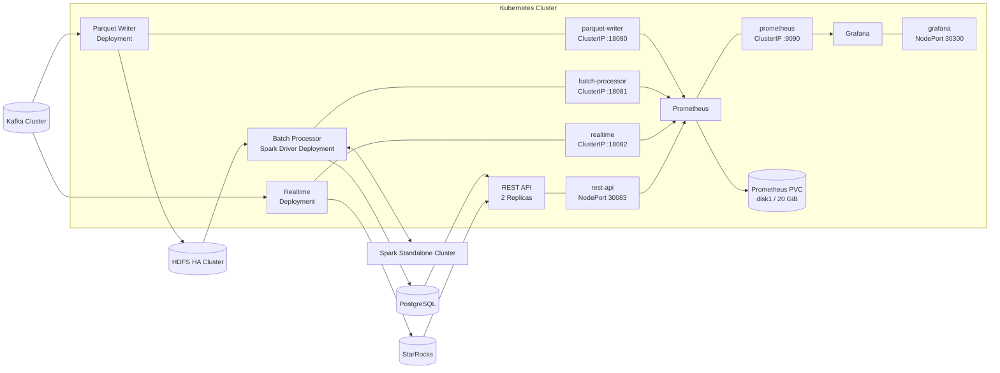
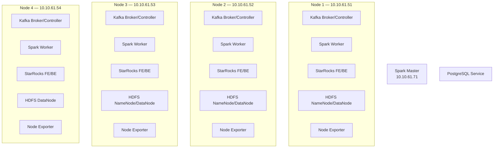
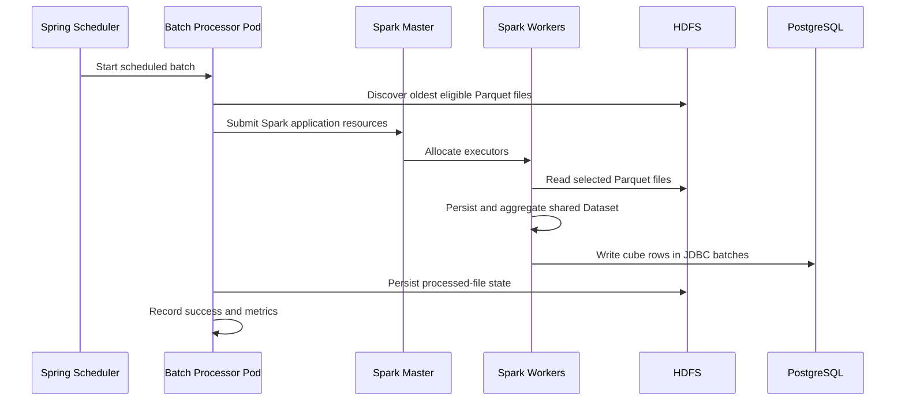
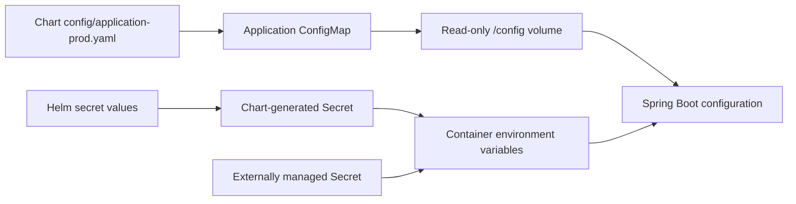
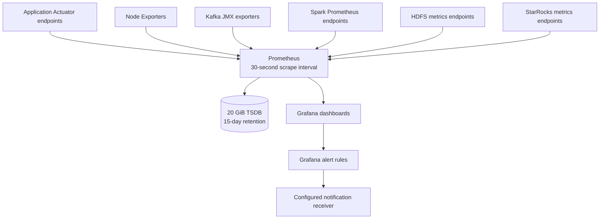

# Nimbo Kubernetes Deployment Technical Report

## 1. Purpose and scope

This report describes the Kubernetes deployment architecture defined by the Nimbo Helm charts. It covers application workloads, services, configuration, secrets, persistent storage, resource allocation, health management, monitoring, and connections to externally managed infrastructure.

The following Helm charts are included:

- `parquet-writer`
- `batch-processor`
- `realtime`
- `rest-api`
- `prometheus`
- `grafana`

Kafka, HDFS, Spark, PostgreSQL, StarRocks, node exporters, the container registry, and the `disk1` StorageClass are infrastructure dependencies. They are consumed by these charts but are not provisioned by them.

This report assumes the previously identified endpoint, HDFS path, PostgreSQL database, Spark connectivity, Grafana, secret, and image-tag inconsistencies have been corrected.

---

## 2. High-level architecture



The two processing paths are:

1. Batch path: Kafka → Parquet Writer → HDFS → Batch Processor/Spark → PostgreSQL → REST API.
2. Realtime path: Kafka → Realtime → StarRocks → REST API.

Prometheus collects application and infrastructure metrics. Grafana reads Prometheus and presents dashboards and alerts.

---

## 3. External infrastructure topology



The application charts do not control these processes. Their availability, replication, storage, authentication, and host-level resource allocation must be managed separately.

---

## 4. Helm workload inventory

| Workload | Replicas | Service | Port | Update strategy | Primary responsibility |
|---|---:|---|---:|---|---|
| Parquet Writer | 1 | ClusterIP | 18080 | RollingUpdate | Kafka-to-HDFS Parquet ingestion |
| Batch Processor | 1 | ClusterIP | 18081 | Recreate | HDFS/Spark aggregation and PostgreSQL writes |
| Realtime | 1 | ClusterIP | 18082 | RollingUpdate | Kafka-to-StarRocks realtime ingestion |
| REST API | 2 | NodePort | 18083 / 30083 | RollingUpdate | PostgreSQL and StarRocks query API |
| Prometheus | 1 | ClusterIP | 9090 | Recreate | Metrics collection and retention |
| Grafana | 1 | NodePort | 3000 / 30300 | RollingUpdate | Dashboards and alerting |

`Recreate` is appropriate for the Batch Processor because concurrent scheduler instances could produce overlapping work. REST API uses two replicas because it is stateless and horizontally scalable.

---

## 5. Parquet Writer deployment

### Kubernetes objects

- One `Deployment`
- One `ClusterIP Service`
- One application `ConfigMap`
- No chart-generated credential Secret

### Runtime configuration

The ConfigMap provides the production Spring configuration through:

```text
SPRING_CONFIG_ADDITIONAL_LOCATION=file:/config/application-prod.yaml
```

The configuration is mounted read-only at `/config`.

### Kafka integration

The ingester consumes the `multi-version-netflow` topic and publishes rejected records to `netflow-dlq`.

Important Kafka behavior includes:

- Three consumer instances inside one application pod
- Manual offset commits
- `auto-offset-reset: earliest`
- Configured polling, session, heartbeat, and maximum-poll intervals
- A bounded maximum number of records per poll

Kafka bootstrap configuration contains multiple brokers to retain startup connectivity if one broker is unavailable.

### HDFS and Parquet

The ingester connects through the logical HDFS nameservice rather than a single NameNode address. This allows the Hadoop client to use the configured NameNode topology.

Parquet behavior includes:

- Snappy compression
- 128 MiB block size
- 1 MiB page size
- Dictionary encoding
- Hour-based HDFS directory partitioning
- Atomic temporary-to-final filename transition

A batch rolls over when any configured limit is reached:

- Maximum record count
- Maximum accumulated size
- Maximum batch age

### Resource envelope

| Resource | Request | Limit |
|---|---:|---:|
| CPU | 250m | 1 core |
| Memory | 512Mi | 1Gi |

The pod receives up to 40 seconds for termination. Spring graceful shutdown and lifecycle timeout settings allow buffered records to be finalized before the pod exits.

---

## 6. Batch Processor deployment

### Kubernetes objects

- One `Deployment`
- One `ClusterIP Service`
- One application `ConfigMap`
- Optional chart-generated Secret or externally managed database Secret

### Spark architecture

The Batch Processor pod acts as the Spark driver. It connects to the external Spark standalone master, which allocates executors on the external Spark workers.



The driver address is injected from the pod IP through the Kubernetes Downward API:

```text
status.podIP → DRIVER_HOST → spark.driver-host
```

External Spark workers must have network routes to the pod network and all configured Spark driver RPC ports.

Spark configuration controls:

- Master endpoint
- Application name
- Executor memory
- Executor cores
- Executor count or total-core limit
- Shuffle partition count
- Adaptive query execution
- Adaptive partition coalescing
- Kryo serialization
- Production Spark UI
- Java NIO transport
- Driver bind and advertised addresses

The executor application JAR must be available through the container image or another explicitly configured distribution mechanism.

### HDFS discovery

The processor reads the same logical HDFS filesystem and Parquet base path used by the Parquet Writer. Hour directories reduce discovery cost before individual filenames are ordered.

### PostgreSQL writing

Credentials are injected through:

- `DB_USERNAME`
- `DB_PASSWORD`

Configuration includes:

- PostgreSQL service address and database
- JDBC batch size
- Connection-pool size and timeout
- Retry attempts
- Initial retry delay
- Maximum retry delay

The chart does not store production credentials directly when external secret mode is used.

### Scheduling and lifecycle

- One replica
- `Recreate` deployment strategy
- Scheduled batch execution
- Graceful server shutdown
- Scheduler termination waiting
- A 60-second Kubernetes termination grace period

### Resource envelope

| Resource | Request | Limit |
|---|---:|---:|
| CPU | 500m | 2 cores |
| Memory | 1Gi | 2Gi |

These limits apply only to the Kubernetes driver pod. Spark executors running outside Kubernetes are controlled by Spark worker capacity, not Kubernetes resource quotas.

---

## 7. Realtime deployment

### Kubernetes objects

- One `Deployment`
- One `ClusterIP Service`
- One application `ConfigMap`
- Optional chart-generated Secret or externally managed Secret

### Processing path

The Realtime pod consumes NetFlow records from Kafka and loads them into StarRocks.

The Kafka configuration controls:

- Bootstrap brokers
- Topic and consumer group
- Client identifier
- Consumer count
- Poll record limit and timeout
- Partition fetch size
- Session and heartbeat timing
- Maximum poll interval

The StarRocks configuration controls:

- Stream-load backend addresses
- Database and table
- Credentials
- Merge-commit behavior
- Merge interval and parallelism
- Maximum in-flight requests
- Retry backoff
- Maximum batch rows
- Maximum batch age

Credentials are supplied through:

- `STARROCKS_USERNAME`
- `STARROCKS_PASSWORD`

### Resource envelope

| Resource | Request | Limit |
|---|---:|---:|
| CPU | 250m | 1 core |
| Memory | 512Mi | 1Gi |

The service remains internal to the cluster. Its HTTP port primarily supports Actuator health and Prometheus metrics.

---

## 8. REST API deployment

### Kubernetes objects

- Two `Deployment` replicas
- One NodePort Service
- One application `ConfigMap`
- Optional chart-generated Secret or external Secret

### Data sources

The API reads batch aggregates from PostgreSQL and realtime records from StarRocks.

PostgreSQL configuration includes:

- JDBC URL
- Driver
- HikariCP connection-pool limits
- Connection and idle timeouts
- Maximum connection lifetime
- Fetch and Hibernate batch sizes
- PostgreSQL dialect
- Disabled Open Session in View

StarRocks has an independent query pool and query constraints.

### API behavior

- Context path: `/api`
- Container port: `18083`
- External NodePort: `30083`
- Response compression
- UTC JSON timestamps
- Pagination limits
- Time-range limits
- Rate limiting
- Database retry and circuit-breaker configuration
- OpenAPI documentation and Swagger UI
- Actuator and Prometheus endpoints

### Secret variables

- `DB_USERNAME`
- `DB_PASSWORD`
- `STARROCKS_QUERY_USERNAME`
- `STARROCKS_QUERY_PASSWORD`

### Resource envelope

Each replica receives:

| Resource | Request | Limit |
|---|---:|---:|
| CPU | 250m | 1 core |
| Memory | 512Mi | 1Gi |

External access is available through:

```text
http://<any-reachable-node>:30083/api
```

---

## 9. Configuration and Secret lifecycle



Each application ConfigMap embeds its production YAML. A checksum annotation is placed on the pod template so a ConfigMap change creates a new Deployment revision.

Secret handling supports two modes:

1. Chart-managed Secret for controlled non-production environments.
2. Externally managed Kubernetes Secret for production.

Production credentials should come from a dedicated secret-management system and must never be committed to chart values.

Secret changes must trigger or be followed by a pod rollout because environment variables are read only when containers start.

---

## 10. Service networking

### Internal services

| Service | DNS name | Purpose |
|---|---|---|
| `parquet-writer` | `parquet-writer:<port>` | Health and metrics |
| `batch-processor` | `batch-processor:<port>` | Health, metrics, and Spark UI if exposed |
| `realtime` | `realtime:<port>` | Health and metrics |
| `prometheus` | `prometheus:9090` | Grafana datasource |

These short DNS names require the workloads to be installed in the same namespace. Cross-namespace access requires fully qualified names.

### External services

| Service | Access model |
|---|---|
| REST API | NodePort `30083` |
| Grafana | NodePort `30300` |
| Kafka | Static host endpoints |
| HDFS | Logical HA nameservice |
| Spark | Kubernetes Service or routable external master |
| PostgreSQL | Kubernetes Service or approved external endpoint |
| StarRocks | Static FE/BE endpoints |

NetworkPolicy rules should explicitly allow only the required flows when network isolation is enabled.

---

## 11. Health checks and shutdown

The Spring applications use startup, readiness, and liveness probes.

- Startup probes provide additional time for JVM, HDFS, Kafka, database, and Spark initialization.
- Readiness probes prevent traffic or monitoring assumptions before initialization completes.
- Liveness probes restart genuinely unhealthy processes.
- Termination grace periods provide time for graceful shutdown.

Batch Processor has a longer startup allowance because Spark initialization and remote cluster registration can take longer than normal HTTP application startup.

REST API readiness should represent its ability to serve queries, while liveness should represent only whether the application process can recover without a restart.

---

## 12. Prometheus deployment

Prometheus is deployed as one pod with:

- A ClusterIP Service on port `9090`
- A 20 GiB `ReadWriteOnce` PVC
- The `disk1` StorageClass
- Fifteen-day TSDB retention
- Readiness and liveness probes
- A `Recreate` strategy to protect single-writer local storage

### Scrape coverage

Prometheus collects:

- Parquet Writer Actuator metrics
- Batch Processor Actuator metrics
- Realtime Actuator metrics
- REST API Actuator metrics
- Node exporter metrics from all four nodes
- Kafka broker and controller metrics
- Spark master and worker metrics
- StarRocks FE and BE metrics
- HDFS NameNode and DataNode metrics

Application targets use Kubernetes Service DNS. Infrastructure targets use host addresses because those components are externally managed.

---

## 13. Grafana deployment

Grafana is deployed as one pod with:

- NodePort `30300`
- A provisioned Prometheus datasource
- File-provisioned dashboards
- File-provisioned alert rules and contact points
- Health probes
- ConfigMap checksum rollouts

The Prometheus datasource UID is stable and matches the UID referenced by dashboard panels and alert rules.

External access is:

```text
http://<any-reachable-node>:30300
```

Dashboards stored in the chart are reproducible after pod replacement. Manually created dashboards are not durable unless Grafana receives persistent storage or they are exported back into chart-managed JSON.

---

## 14. Monitoring flow



Prometheus is the metrics authority. Grafana does not scrape workloads directly.

---

## 15. Storage model

| Consumer | Storage | Kubernetes ownership |
|---|---|---|
| Parquet Writer | External HDFS | Not provisioned by charts |
| Batch Processor | External HDFS and PostgreSQL | Not provisioned by charts |
| Realtime | External StarRocks | Not provisioned by charts |
| REST API | No application state | Stateless |
| Prometheus | 20 GiB `disk1` PVC | Provisioned by Prometheus chart |
| Grafana | ConfigMap provisioning | No persistent UI database volume |

The Prometheus PVC is node-local. Kubernetes can preserve the volume across pod restarts, but it does not provide storage-level high availability if the bound node becomes unavailable.

---

## 16. Security controls

Implemented controls include:

- Service-account token mounting disabled for application pods
- Linux capabilities dropped from application containers
- Configuration mounted read-only
- ClusterIP exposure for internal services
- Secrets separated from ConfigMaps
- Credentials referenced through environment variables
- Health details restricted where configured

Production deployment should additionally enforce:

- Immutable image tags or digests
- Non-root users
- Seccomp profiles
- Read-only root filesystems where supported
- Image pull credentials for the private registry
- External secret management
- TLS for externally exposed services
- NetworkPolicies
- Restricted namespace-level Pod Security admission
- Authenticated Grafana administration
- Backup and recovery procedures for Prometheus and external databases

---

## 17. Scheduling and availability characteristics

The charts do not define node selectors, affinities, topology spreading, or PodDisruptionBudgets.

Therefore:

- Application pods can run on any schedulable worker node.
- REST API replicas are not guaranteed to run on different nodes.
- Grafana and Prometheus are single-instance services.
- Prometheus availability depends on the node hosting its local PVC.
- External Spark executor consumption is invisible to Kubernetes scheduling.
- Host-level Kafka, HDFS, Spark, and StarRocks resource use must be considered when calculating Kubernetes allocatable capacity.

For predictable placement, node labels and topology rules should be defined according to the final cluster policy.

---

## 18. Deployment prerequisites

Before installing the charts, the environment must provide:

1. A target namespace and release naming policy.
2. Access to the private container registry.
3. Immutable application image tags.
4. Required Kubernetes Secrets.
5. The `disk1` StorageClass.
6. Reachable Kafka brokers.
7. A working HDFS logical nameservice.
8. A Spark master Service and executor-to-driver network route.
9. PostgreSQL and StarRocks endpoints.
10. Node exporter and infrastructure metrics endpoints.
11. A valid Grafana administrator credential.
12. A real Grafana notification receiver.
13. DNS resolution between application services and monitoring.
14. Sufficient node capacity for both Kubernetes pods and externally running big-data processes.

---

## 19. Deployment conclusion

The chart architecture separates application workloads from the existing distributed-data infrastructure:

- Kubernetes manages application processes, health, configuration, services, and monitoring.
- Kafka provides ingestion transport.
- HDFS provides durable batch storage.
- Spark performs distributed batch processing.
- PostgreSQL stores batch aggregates.
- StarRocks stores realtime analytical data.
- REST API exposes both analytical paths.
- Prometheus and Grafana provide operational visibility.

The design is suitable for the current four-node environment provided that external-service connectivity, Spark driver routing, shared configuration contracts, secret delivery, immutable images, and node-capacity reservations are verified before production rollout.
