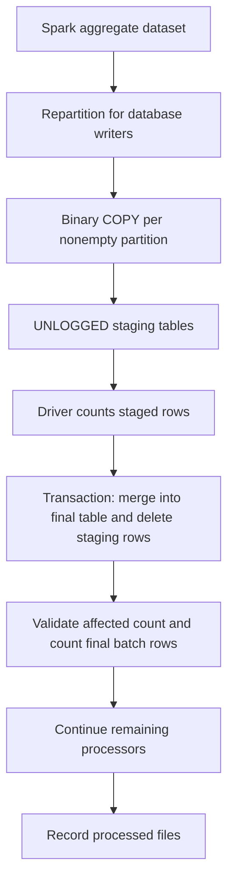
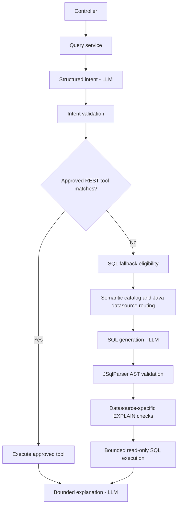

# Engineering case study

## 1. Problem and contribution boundary

Network-flow data needs two complementary query paths: detailed records for flexible investigation, and smaller analytical cubes for common time-bounded queries. My work focused on turning the batch path into an observable service, serving its data consistently, and adding a controlled natural-language interface across the aggregate and raw stores.

The platform was developed by a team. My source history supports substantial work on Cube Maker, PostgreSQL persistence, REST endpoints, Analytics Query, tests, Spark packaging and monitoring. Kafka/StarRocks ingestion and the full infrastructure stack should be described as team work, with my targeted contributions identified separately.

## 2. Cube Maker: bounded, reusable Spark processing

Spring scheduling starts batch runs inside a long-lived application. This keeps scheduling, health, metrics and state in one lifecycle. It also suits a workload that often runs almost continuously: creating a separate CronJob pod for every run would offer limited idle-resource savings under that workload.

Each run performs maintenance, discovers the oldest eligible unprocessed Parquet files within a configured file limit, ensures required PostgreSQL partitions, reads a shared source dataset, materializes it, runs the cube processors, and records processed files after successful outputs. The dataset is explicitly unpersisted afterward.

| Cube | Analytical grain and metrics |
| --- | --- |
| Traffic | Source IP and hourly window; inbound/outbound bytes, packets and record count |
| Connections | Source/destination IP pair and hourly window; directional bytes and packets |
| IP bandwidth | IP and hourly window; inbound/outbound byte and packet semantics |
| Protocol usage | Protocol and hourly window; bytes, packets and connection count |

Current processing uses processing-time windows with UTC semantics. This is an analytical choice, not equivalent to arbitrary event-time analysis.

### Why the shared cache matters

Spark actions are lazy. An aggregate count followed by a database-write action can evaluate the aggregate plan again. Persisting the source prevents those processors from independently rereading the same Parquet source during normal cache reuse; it does not automatically persist every aggregate result or eliminate every shuffle. Lost cache partitions can still require recomputation.

### What three Spark jobs mean

The saved execution shows multiple jobs beneath a single count or COPY action. Adaptive execution and shuffle boundaries can split one SQL action into several jobs. These are not automatically retries or three database writes.

For the visible traffic COPY execution, stages 276 and 278 prepare/shuffle the aggregate and stage 281 runs the four partition writers. For connections, stages 288 and 290 prepare/shuffle and stage 293 runs the four writers. The final driver-side JDBC merge is outside those Spark tasks.

## 3. PostgreSQL writing: separating transport from merge cost

Traffic, connection and bandwidth results use this path:

`StagingPartitionWriter` serializes rows into a buffered binary COPY stream. Although Java iterates through rows, this is not a separate SQL INSERT and retry for each row. Each nonempty Spark partition owns a transaction, removes its previous staged attempt, completes COPY and commits.

Staging tables are `UNLOGGED`: their row changes do not use normal table-data WAL durability. They are intermediate, rebuildable data, not the authoritative serving results. The final tables remain logged. Losing staging requires reprocessing; it is not silently repaired by declaring the table unlogged.

### Retry boundaries

| Operation | Current behavior |
| --- | --- |
| Partition COPY | Attempts cancellation/rollback on failure and throws; Spark task retry policy can rerun the partition |
| Staging-to-final merge | Driver-side JDBI transaction; no explicit `BatchExecutor` retry loop around this path |
| Protocol UPSERT | `PartitionWriter` uses `BatchExecutor` to retry a batch with bounded exponential backoff |
| Handled failed batch | Can reuse the failed batch ID while that state remains in the running process |

This distinction matters operationally: adding retry settings to the batched protocol path does not automatically add retries to COPY or the driver merge.

### Recovery limitations

Processed-file records are stored in PostgreSQL, but `failedBatchId` is an in-memory field. The four cube writes and processed-file update are not one global transaction. A driver restart after partial final-table commits therefore needs careful replay handling; this report does not claim end-to-end exactly-once processing across crashes.

The file-state service can fall back to memory when PostgreSQL state persistence fails. A successful run indicator must be interpreted alongside state-persistence health. Likewise, a dashboard label such as “DURABLE” is not proof of all failure guarantees.

## 4. Schema, retention and query tradeoffs

Versioned Flyway migrations make the database evolution inspectable:

- Final IP columns move from text to `INET`.
- Unused surrogate IDs and redundant indexes are removed where logical keys already cover the requirement.
- Connection identity retains SHA-256 but stores the digest as 32-byte binary data rather than 64 hexadecimal characters.
- An attempted integer-counter reduction is superseded by restoring `BIGINT`, because aggregate counts can exceed 32-bit capacity.
- Daily partition management supports the PostgreSQL retention workflow.

The current maintenance service is for PostgreSQL. Spark-history retention was removed from Cube Maker; automatic Spark-history cleanup is also disabled in the inspected Spark chart. That avoids the earlier cleanup-permission problem but leaves disk growth requiring a separate operational policy.

Index removal must be justified against actual REST predicates, ordering and plans. Faster writes are not useful if essential serving queries become unacceptably slow.

## 5. REST API: matching storage semantics

The API exposes traffic, connections, bandwidth and protocol operations with validated time ranges, pagination, sorting and limits. Its aggregate queries must combine fragments from different batch IDs into the requested logical windows instead of presenting storage fragments as independent analytical facts.

Swagger/OpenAPI examples make the contracts demonstrable. PostgreSQL cube endpoints and StarRocks detail endpoints serve different grains; choosing between them is a semantic decision, not merely choosing whichever database responds faster.

## 6. Analytics Query: controlled model assistance

The service uses a hosted model through a small OpenAI-compatible adapter, avoiding ownership of a separate GPU-serving and model-training stack. Model identity and endpoint are configurable; the report does not depend on the deployment's private model alias.

### Safety controls by stage

| Stage | Responsibility |
| --- | --- |
| Intent and eligibility | Clarify ambiguity; reject destructive/out-of-scope requests; validate fields, time ranges and supported analytical coverage |
| Routing and prompt construction | Java chooses aggregate PostgreSQL or approved raw StarRocks semantics; send only the selected approved schema |
| AST policy | Enforce one read-only SELECT, table/column/function allowlists, time and row bounds; reject joins and nested queries |
| Query planning | Apply datasource-specific estimated-row checks and PostgreSQL cost thresholds |
| Execution | Separate read-only database access, bounded connection pools, statement timeout and result-size limits |
| Explanation | Bound the result context sent to the model; preserve successful data if explanation fails |

A failed REST tool does not silently trigger SQL fallback. The semantic catalog contains meanings, grain, dimensions, metrics and capabilities—not just physical column names.

The StarRocks catalog refreshes at startup and, by default, every 15 minutes after each scheduled refresh completes. It reads physical metadata, retains approved semantics, and replaces the catalog snapshot; refresh failures retain the last good snapshot.

Base application defaults include a 7-day intent time-range cap, a 10-second SQL statement timeout, a 2 MB result cap and two-connection execution pools per datasource. These are configuration defaults, not confirmation of live deployment overrides. Plan estimates are protective heuristics, not guaranteed execution times.

## 7. Testing and delivery

Maven Surefire runs unit tests, while Failsafe runs integration suites. Source includes real-database and container-backed tests for Cube Maker processors and writers, REST PostgreSQL queries, and analytics routing, catalog, plan checking and execution. JaCoCo supplies coverage, Checkstyle enforces style, and SonarQube provides quality analysis.

Jenkins separates CI, infrastructure preparation, application release and backfill workflows. My contributions include service build/deployment integration, Spark artifact handling, test stability, analysis fixes and moving build work away from the root disk. These are contributions within shared pipelines, not sole authorship of every delivery component.

A historical deployment failure illustrates configuration ownership: Helm encountered memory-field conflicts with a prior `kubectl-set` manager on Parquet Writer, and rollback encountered the same conflict. Passing a preceding validation step did not prove that applying the release would succeed. This is a documented failure mode, not a claim that the current scripts automatically reconcile field ownership.

## 8. Spark deployment and observability

The chart packages a standalone Spark cluster inside Kubernetes: one master, four workers and a History Server. This is different from Spark's native Kubernetes executor allocation mode.

Worker StatefulSets and PVCs provide stable identity and persistent work/log paths. They do not themselves enable shuffle recovery, Spark-master state recovery, or cross-node disk portability. The inspected configuration does not enable a master recovery backend or the native Kubernetes shuffle-recovery plugin.

Spark RPC and worker services use internal services; selected UIs are separately exposed. This reduces externally reachable control surfaces but is not a substitute for authentication, firewall rules or NetworkPolicies. The Cube Maker chart injects its actual pod IP for driver callbacks instead of relying on a stale fixed host address.

Prometheus discovery uses a dedicated service account and scoped RBAC. The inspected chart configures 15-day retention and a 20 GiB data PVC; Grafana has a 2 GiB PVC. Repository-managed dashboards cover infrastructure, nodes, current storage, Cube Maker and Analytics Query, alongside team ingestion dashboards.

Operational questions informed the instrumentation: Is a batch progressing? Which stage is slow? Are final rows being written? Did state persist? Which dependency rejected or delayed an analytics request? Pod readiness alone cannot answer those questions.

## 9. Performance investigation and lessons

The saved Spark view shows traffic's four-writer stage taking approximately 19 seconds and connections' four-writer stage approximately 22 seconds. These are whole-stage durations, not individual database-call timings or complete batch times. A separate Grafana capture shows much longer PostgreSQL-write phases, making the driver/database work a meaningful investigation target. The captures are not a controlled same-batch benchmark.

The staged-write timer combines Spark work, staging counts, the merge and staging cleanup; a final-table recount occurs afterward. Without separate timing or database samples, neither the recount nor a particular index can be assigned all of the delay.

The PostgreSQL chart currently requests 2 GiB and limits 3 GiB per database pod, with `shared_buffers` at 512 MB. This records the selected memory experiment; it does not demonstrate an improvement. A larger limit can help only if usable memory and cache pressure are relevant, with enough node headroom during concurrent Spark and ingestion load.

Key lessons:

1. Separate Spark computation, partition COPY, database merge, cleanup and verification before tuning parallelism.
2. Increasing executor cores cannot directly parallelize the single driver-issued SQL merge.
3. Treat database indexes as a read/write tradeoff, not disposable overhead.
4. Kubernetes restart, persistent storage and application replay correctness are different guarantees.
5. Keep model assistance inside deterministic application and database boundaries.

## 10. Follow-up work, not claimed as completed

- Persist a durable batch manifest/status and stable replay identity across driver restarts.
- Instrument merge, cleanup and verification separately; measure comparable batches before/after tuning.
- Validate Spark master/driver failure behavior with controlled failure tests.
- Maintain a repeatable analytics evaluation set covering tools, both SQL stores, safe rejection and explanation failure.
- Reconcile declarative deployment ownership and review exposed UIs before public or wider-network use.

See [the evidence map](EVIDENCE.md) for source locations and the limits of the review.
