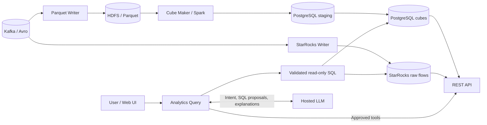

# Nimbyte — Network Analytics Engineering Report

**Mahdi Mokhtari · August–October 2026 · Prepared 10 October 2026**

Nimbyte is a team-built network-flow analytics platform combining Kafka ingestion, HDFS/Parquet history, Spark aggregation, PostgreSQL serving tables, StarRocks detailed-flow analytics, and a guarded natural-language query interface.

My main contributions were the **Spark Cube Maker, PostgreSQL aggregation/write path, REST query contracts, Analytics Query service, and supporting testing, deployment, and observability work**. This report separates those contributions from the wider team's platform work.

## At a glance

| Area | Work and purpose |
| --- | --- |
| Batch analytics | Four hourly cube families, bounded file discovery, one shared cached source dataset, executor-side database writes |
| PostgreSQL | Binary COPY into rebuildable staging, transactional merges, partition maintenance, schema and index optimization |
| Query APIs | Validated REST contracts, pagination and limits, aggregation across batch fragments |
| Natural-language analytics | Tool-first execution; Java-controlled routing, SQL validation, plan checks and read-only execution |
| Deployment | Spark and application Helm packaging, driver networking, persistent worker storage, CI/CD integration |
| Quality and operations | Unit/integration tests, metrics, dashboards, alerts, and evidence-based performance diagnosis |

## Architecture

Kafka, HDFS, StarRocks and infrastructure automation are shared platform context, not a claim of sole authorship. The language model proposes; application code decides what may execute.

## Engineering highlights

- Reused one `MEMORY_AND_DISK` source dataset across four Spark processors instead of independently rereading source files for every processor action.
- Moved large-result persistence to executor-side partition writers, avoiding collection of the entire result on the driver.
- Added binary COPY staging for traffic, connections and bandwidth, while retaining batched UPSERT for the smaller protocol cube.
- Evaluated storage reduction without sacrificing counter correctness: final IP columns use `INET`, connection hashes use binary storage, and aggregate counters remain `BIGINT`.
- Aligned REST results with the cube grain, including combining logical windows that span multiple ingestion batches.
- Built a tool-first analytics service with a curated semantic catalog and layered SQL controls rather than granting a model unrestricted database access.
- Added operational visibility into batch outcomes, stage duration, output rows, state persistence and query execution.

## Evidence, not inflated claims

The inspected Git history contains **96 non-merge commits** attributed to my two author-name variants. This establishes an implementation trail, not a productivity score or sole ownership of the platform.

A captured SonarQube page reports a **passed quality gate and 80.8% new-code coverage** for its displayed analysis dated 9 October 2026. These are project-level historical results, not overall coverage, personal coverage, or a fresh test run.

The saved Spark and Grafana views document actual execution and write-path investigation. They do **not** establish a controlled before/after performance improvement. No throughput multiplier, end-to-end exactly-once guarantee, or automatic Spark application recovery is claimed here.

## Read the report

- [Engineering case study](ENGINEERING-REPORT.md): implementation, decisions, failure boundaries and lessons.
- [Contribution timeline](CONTRIBUTIONS.md): representative commits and attribution.
- [Evidence and source map](EVIDENCE.md): code locations, observations and verification limits.
- [Screenshot plan](SCREENSHOTS.md): suggested figures and what each can demonstrate.
- [Publishing checklist](PUBLISHING.md): privacy review and GitHub handoff.

The public-facing Markdown deliberately omits credentials, internal service addresses and private conversations. Selected original screenshots are retained separately under the Git-ignored `private-evidence/` directory; they require redaction and approval before publication.

## Technology

Java 17, Spring Boot, Apache Spark, Kafka, Avro, HDFS, Parquet, PostgreSQL, StarRocks, JDBI, Flyway, JSqlParser, JUnit, Testcontainers, Maven Surefire/Failsafe, JaCoCo, SonarQube, Jenkins, Jib, Kubernetes, Helm, Prometheus and Grafana.

## Scope and provenance

Prepared from the local source tree at commit `891e9f0`, the current presentation draft, technical reports, author history, previously supplied operational context, and existing UI captures. The presentation had an existing local modification and was left untouched. This report is a source/evidence review, not a new production-health certification.
